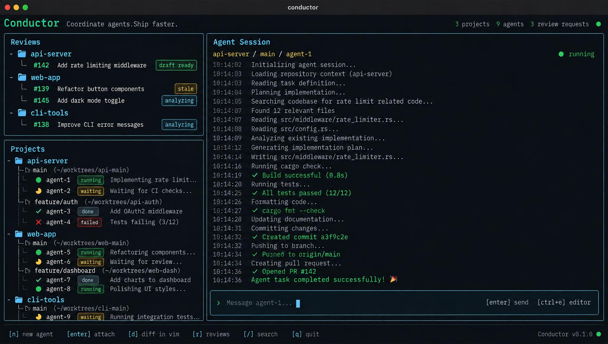

# A terminal workspace for coding agents

## The problem

Developers who live in the terminal already have powerful tools for writing code. Coordinating the work around those tools takes more effort. One agent is implementing a feature, another is waiting for input, a third has failed a test, and a teammate has requested a review. Each lives in a different tab, checkout, or browser page.

As parallel work grows, keeping track becomes work of its own. Which project needs attention? Where did that agent leave its changes? Has the pull request changed since you reviewed it? Answering those questions should take a glance. Our product brings projects, Git worktrees, coding agents, and incoming reviews into one keyboard-driven terminal dashboard.

## The experience

Open the dashboard from your usual shell. See your projects, expand their worktrees, and find the agents attached to each task. Reviews and project navigation sit beside the active session, keeping the wider picture visible while you focus on one piece of work.

Start a task with an established coding agent in its own Git worktree. It gets a separate checkout and branch, so independent tasks can progress without agents editing the same working files. Move to another project while the agent works. When it needs you, jump back into its session with the task's context at hand.

Open the diff in Vim when you want to inspect the changes closely. Return to the dashboard and continue from there. The workflow should fit the shell, editor, and Git habits you already rely on. Navigating between tasks should feel as direct as switching buffers.

The UI target brings reviews and a project tree beside a prominent active session, with clear status labels and visible keyboard actions. Implementation should work toward this composition from the first usable UI slice. The product name is still undecided.

> UI target. Preserve the overall composition and visual direction, adapting to terminal size and supported behavior. Raise feasibility problems and material deviations explicitly. Branding, exact keybindings, and example content remain illustrative; confirmed product behavior governs conflicts in the image.

## Reviews ready for your judgment

When someone requests your review on GitHub, a background agent reads the PR description, examines the diff, and considers the CI results. It prepares a local review draft and notifies you when it is ready, so you can keep working while the preparation happens.

Open the draft beside the diff. Read each suggested comment in context, rewrite it in your own words, or drop it entirely. Add observations the agent missed. You decide which comments to send and explicitly submit the review. Preparation can happen automatically; publishing a review requires your decision.

Every draft identifies the revision it examined. If the author pushes new commits, the draft is marked stale. You can see that its suggestions describe an earlier version and revisit the changed code before submitting. The goal is a useful starting point for your judgment, with a clear record of what was examined.

## Product principles

The dashboard must remain responsive while agents produce output, tests run, and reviews are prepared. Moving between projects and opening a session should feel immediate. Background activity should leave you free to navigate.

State must be easy to read. Running, waiting, completed, and failed agents should be distinguishable through clear labels, with enough context to understand what needs attention. Review preparation, ready drafts, and stale drafts should be equally visible. Notifications should bring you back when there is something useful to act on.

Independent coding tasks belong in separate worktrees. Familiar terminal tools remain central to inspecting and editing the work. Agent suggestions remain editable, and review submissions remain under human control. These principles should hold as the number of projects and active agents grows.

## The promise

Built in Rust, the product will make coordinating busy agents feel fast and predictable. It will work with established coding agents through developers' own accounts or API keys. The tool itself will be free; any charges for agent subscriptions or API usage remain the developer's responsibility. The license is still undecided.

The first usable release will bring both workflows together: coordinating local coding-agent sessions across projects and worktrees, and preparing local GitHub review drafts for human submission. Success means you can find the work that needs you, understand its current state, and take the next step from your terminal.
